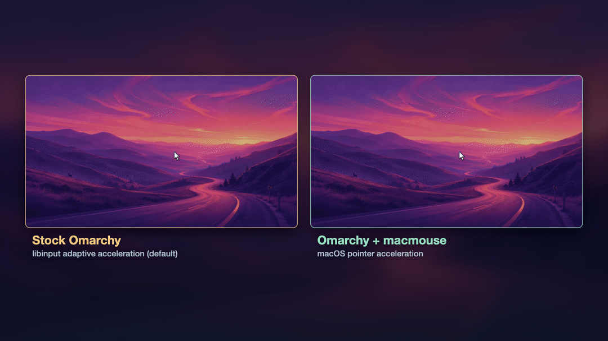

# macmouse

**macOS mouse pointer physics for Hyprland (Omarchy and other Linux desktops).**

<p align="center">
  <a href="media/macmouse.mp4"></a>
</p>

<p align="center"><sub>Same hand motion, same 1600 CPI mouse. Cursor paths are real recordings from Hyprland; the dashed path is macOS, computed from Apple's own accelerator outputs. <a href="media/macmouse.mp4">MP4 with music</a> · <a href="media/src">how it was made</a></sub></p>

If you switch between a Mac and a Linux desktop, the mouse feels different:
libinput's adaptive acceleration has a different curve, different units and
velocity smoothing. macmouse is a Hyprland plugin that replaces it, for the mice you
choose, with the exact arithmetic macOS 26.5 uses for pointer movement:

- Apple's table acceleration, applied per HID report to raw counts, bit for bit
- the binary32 rounding of the NX event layer
- WindowServer's truncating 24.8 fixed-point cursor position

It supports all ten positions of the macOS tracking-speed slider. The model matches
**864,300 outputs recorded from Apple's own accelerator (86,430 per slider position),
bit for bit**. Inside a running Hyprland session, the cursor follows those values exactly
for every injected event. See [How macOS moves the mouse pointer](docs/ALGORITHM.md)
and [Verification](docs/VERIFICATION.md).

Pointer movement only; wheel scrolling is unchanged.

## Requirements

- Hyprland with development headers. Arch/Omarchy: `hyprland` ships them under
  `/usr/include/hyprland`. Tested on Hyprland 0.56.2 with Lua config (Omarchy 4);
  hyprlang configs are also supported by the installer.
- `g++` (C++23), `make`, `pkg-config`, `python3`
- For `make verify`: write access to `/dev/uinput` (usually granted to the
  logged-in user through uaccess)

## Install

```sh
git clone https://github.com/advait/macmouse ~/.local/src/macmouse
cd ~/.local/src/macmouse
make check                       # portable model vs Apple's outputs (864300 rows, 0 mismatches)
hyprctl devices                  # find your mouse's name under "mice"
tools/install.sh --speed 10 razer-razer-basilisk-v2   # your Mac's slider tick; your mouse's name(s)
make verify                      # optional: live end-to-end check (~10 s, moves the cursor)
```

`tools/install.sh`:

1. writes the device names to `~/.config/macmouse/devices` and the tracking speed
   to `~/.config/macmouse/tracking-speed`
2. adds one autostart line, tagged `macmouse autostart`, to
   `~/.config/hypr/autostart.lua` (or `hyprland.lua`/`hyprland.conf`), after saving a
   `.bak.macmouse` copy
3. runs `tools/load.sh`, which builds the plugin, validates it in a throwaway nested
   Hyprland (a window flashes briefly), and loads it

At every Hyprland start, `tools/load.sh` loads the validated build. After a Hyprland
update it rebuilds and re-validates first. If anything fails you get a notification
and stock behavior. Log: `~/.local/state/macmouse/load.log`.

### Match your Mac's setup

- **Mouse CPI**: macOS does not normalize by mouse DPI. Use the same CPI on both
  machines; the shipped profile was captured at 1600 CPI, 1000 Hz.
- **Tracking speed**: in System Settings › Mouse › Tracking speed, count the slider's
  ticks from Slow (1) to Fast (10), and use the same tick here. The slider snaps to
  these ten positions, and each writes one value to `com.apple.mouse.scaling`. On the
  Mac, `defaults read -g com.apple.mouse.scaling` tells you which one you have:

  | tick | 1 (Slow) | 2 | 3 | 4 | 5 | 6 | 7 | 8 | 9 | 10 (Fast) |
  | --- | --- | --- | --- | --- | --- | --- | --- | --- | --- | --- |
  | `com.apple.mouse.scaling` | 0 | 0.125 | 0.5 | 0.6875 | 0.875 | 1 | 1.5 | 2 | 2.5 | 3 |

  Change it any time with `tools/speed.sh <tick>`, which saves it and applies it
  immediately. Run `tools/speed.sh` with no argument to print this table and the
  current setting. The default is 10.
- **Display scale**: for identical physical travel, Hyprland's mm per logical pixel
  should match your Mac's mm per point. See the
  [physical scale table](docs/ALGORITHM.md#physical-scale). For example, a 27" 4K
  monitor at scale 1.5 matches a 32" 6K Mac display at default scaling within 1%.

## Use

```sh
hyprctl macmouse status          # enabled, self-test, devices, counters
hyprctl macmouse disable         # stock libinput behavior until `enable`
hyprctl macmouse speed 7         # tracking-speed tick for this session (tools/speed.sh persists it)
hyprctl macmouse devices a,b     # change devices for this session
```

Your `input:sensitivity` and `accel_profile` settings no longer affect selected
mice. Raw relative motion for games (`zwp_relative_pointer`) is unchanged.

## Uninstall

```sh
tools/uninstall.sh               # removes the autostart line, unloads, deletes builds
```

## Layout

| path | what |
| --- | --- |
| `src/pointer_profile.hpp` | portable model of macOS table acceleration |
| `src/macmouse.cpp` | Hyprland plugin |
| `profiles/tracking-speeds.hex.csv` | the curve segments macOS builds for each slider tick (exact binary64) |
| `tests/vectors/speed-NN.csv.gz` | 86,430 outputs recorded from Apple's accelerator per tick |
| `tests/check_model.cpp` | bit-exact model check (`make check`) |
| `tools/nested_check.py`, `tools/probe_plugin.cpp` | isolated nested-compositor gate |
| `tools/live_verify.py` | live uinput end-to-end check (`make verify`) |
| `tools/load.sh`, `tools/install.sh`, `tools/uninstall.sh`, `tools/speed.sh` | deployment |

## Limits

- macOS 26.5 with the default acceleration table, at the slider's ten positions.
  Values set outside the slider with `defaults write` are not supported.
- Assumes macOS delivers third-party mouse motion immediately rather than
  resampling it; this affects timing, not distance.
- Different physical mice can differ in real CPI even at the same setting.
- The hooks use exact Hyprland symbols; a Hyprland release that renames them makes
  the loader refuse with a notification until macmouse is updated.

## License

MIT for this project's code. The acceleration curve derives from Apple's
`defaultAccelTable` in IOHIDFamily, which is published under the Apple Public
Source License 2.0; see [NOTICE](NOTICE). This project is not affiliated with
Apple.
